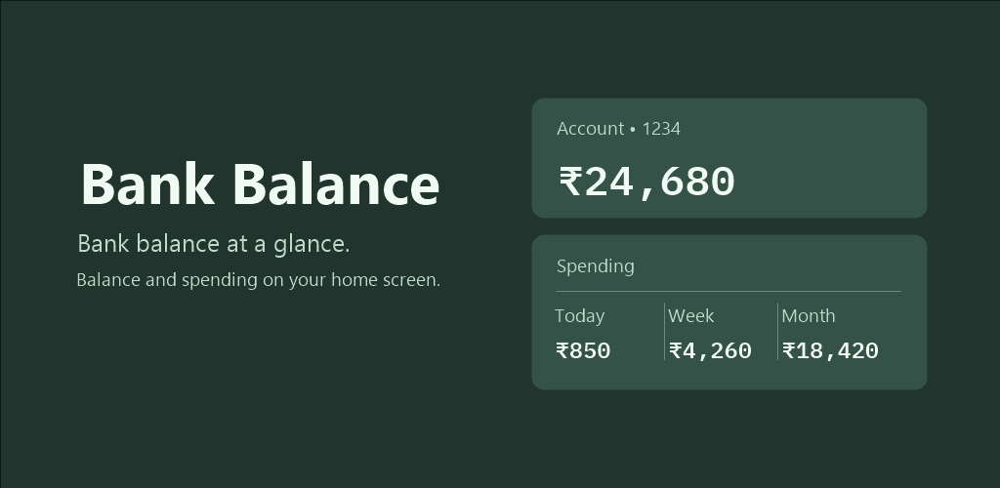
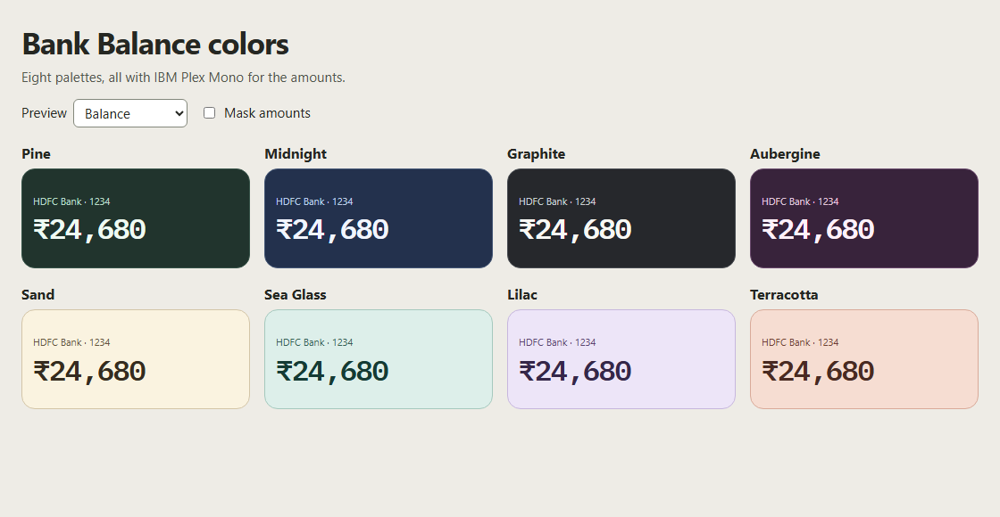

# Bank Balance Widget

**See your bank balance and spending without opening a banking app.**

Bank Balance Widget turns Indian bank transaction SMS into home-screen widgets. Give each account its own balance or spending tile, choose a color theme, and pick a hidden-amount face in Appearance. With widget privacy enabled, tap an amount to reveal or hide it.



## Widget colors



## How it works

1. Scan up to 100 recent messages to find supported bank accounts.
2. Pick your accounts and confirm each starting balance.
3. Add a **Bank balance** or **Money spent** widget. Matching SMS update your numbers automatically.

See debits tracked since setup for today, this week, and this month. The balance uses the available balance from a matching bank alert when possible, or estimates it from credits and debits. Tap a widget to correct the balance if an alert was missed.

SMS processing stays on your phone. No sign-in, internet permission, or cloud sync. Coverage depends on your bank's sender IDs and message format.

## Credit cards

Open **Credit cards**, scan recent SMS, and select a detected card. Set its current outstanding once from your bank app. Add a **Credit card balance** widget to see that running estimate alongside the latest statement amount and due date.

Supported purchase SMS increase the estimate. Confirmed payments, refunds and reversals reduce it. Refresh scans the latest 100 inbox messages and deduplicates accepted transactions. The statement bill stays separate and updates only from bill alerts. Missed or unsupported messages can cause drift; tap the header to correct the outstanding.

Cards can be detected from purchase alerts before the first statement. Historical messages before the starting balance do not change it. The initial parser supports explicit currency amounts and four visible card-ending digits. Unknown or ambiguous messages are skipped.

Public reference formats include [ActSMS bill examples](https://github.com/carthworks/ActSMS) and [open SMS parsing rules](https://gist.github.com/vs4vijay/925ebb800407535ad412982033771faa). Bank documentation explains [ICICI total and minimum dues](https://www.icici.bank.in/personal-banking/blogs/card/credit-card/how-to-check-your-credit-card-balance-and-due-amount) and [HDFC statement and due dates](https://www.hdfc.bank.in/blogs/credit-cards/how-to-understand-credit-card-statement). Parser tests use synthetic messages written for this project.

## Install

Download `BankBalanceWidget.apk` from [GitHub Releases](https://github.com/s-bhatla/BankBalanceWidget/releases/latest). Install it on an Android 8.0 or newer phone with USB debugging enabled:

```sh
adb install -r BankBalanceWidget.apk
```

Open Bank Balance, grant SMS access, scan for accounts, and add a widget from your launcher. The release APK is debug-signed so it can update earlier builds signed with the same key.

## Build

Requires JDK 17, Gradle 8.13, Android SDK Platform 36, and Build Tools 35.0.0. Supports Android 8.0 and later.

```sh
gradle testDebugUnitTest assembleDebug
```

Install the APK from `build/outputs/apk/debug/` with ADB, then grant SMS access in the app. Android restricts SMS access based on the installation method.

Widget amounts use [IBM Plex Mono](src/main/assets/OFL-IBM-Plex-Mono.txt).
